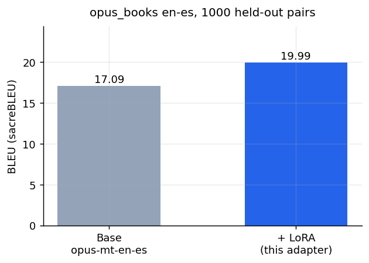
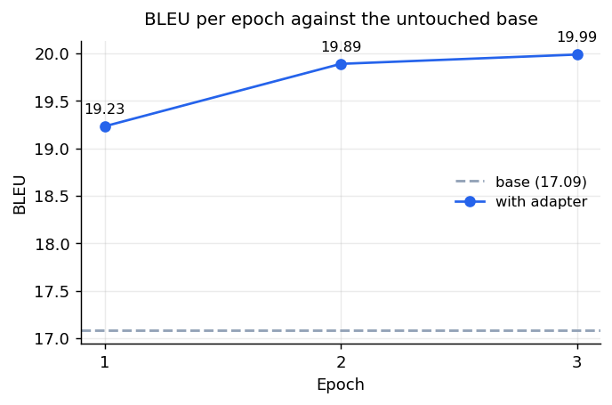

---
language:
  - en
  - es
license: apache-2.0
library_name: peft
pipeline_tag: translation
base_model: Helsinki-NLP/opus-mt-en-es
base_model_relation: adapter
tags:
  - translation
  - lora
  - peft
  - marian
  - en-es
datasets:
  - opus_books
metrics:
  - bleu
model-index:
  - name: omt-en-es-books
    results:
      - task:
          type: translation
          name: English to Spanish translation
        dataset:
          name: opus_books en-es
          type: opus_books
          config: en-es
          split: test
        metrics:
          - type: bleu
            name: sacreBLEU
            value: 19.99
---


<div align="center">

[Hugging Face](https://huggingface.co/emonHasan01) | [GitHub](https://github.com/Md-Emon-Hasan) | [LinkedIn](https://www.linkedin.com/in/md-emon-hasan-695483237/) | [WhatsApp](https://wa.me/8801834363533) | [Portfolio](https://emonlabs-ai.hitechparks.com/)

**Author:** [Md. Emon Hasan](https://huggingface.co/emonHasan01)

</div>

# omt-en-es-books

A LoRA adapter for [`Helsinki-NLP/opus-mt-en-es`](https://huggingface.co/Helsinki-NLP/opus-mt-en-es), trained on
[`opus_books`](https://huggingface.co/datasets/opus_books) (en-es) to adapt an
already-strong translator toward literary prose.

**This repository holds adapter weights only (2.4 MB). It does nothing without
the base model.**

On 1,000 held-out sentence pairs it scores **19.99 sacreBLEU**, against
**17.09** for the untouched base model — a change of **+2.90**.

The adapter improves on the base model on this domain.

## Results



| | sacreBLEU | vs base |
|---|---|---|
| `Helsinki-NLP/opus-mt-en-es` (untouched) | 17.09 | — |
| **+ this adapter** | **19.99** | **+2.90** |

Measured on 1,000 pairs from the held-out 20% split, beam size 4, sacreBLEU with
default tokenisation.



| Epoch | sacreBLEU | vs base |
|---|---|---|
| 1 | 19.23 | +2.14 |
| 2 | 19.89 | +2.80 |
| 3 | 19.99 | +2.90 |

The checkpoint published here is the best epoch by BLEU, not the last one.

## Translations side by side

| English | Reference | Base | With adapter |
|---|---|---|---|
| Kitty, on the contrary, was more active than usual and even more anima | Kitty, al contrario, estaba más activa a incluso más animada que nunca | Kitty, por el contrario, estaba más activa que de costumbre y aún más  | Kitty, por el contrario, estaba más activa que de costumbre y aún más  |
| All necessary preparations shall be made for your return. | Se darán las órdenes necesarias para su regreso. | Se harán todos los preparativos necesarios para su regreso. | Se harán todos los preparativos necesarios para su regreso. |
| Maintenant partons, allons, allons vers Sion. | ¡Demasiado larga ha sido ya la pausa! ¡Adelante! | Los partens, los allons, los allons de Sion. | Los inquilinos son partens, allons, allons vers Sion. |
| Thursday, Aug. | Jueves 20 de agosto. | Jueves, agosto. | Jueves, agosto. |

## Usage

The adapter needs its base model:

```python
from transformers import AutoTokenizer, AutoModelForSeq2SeqLM
from peft import PeftModel

tok  = AutoTokenizer.from_pretrained("emonHasan01/omt-en-es-books")
base = AutoModelForSeq2SeqLM.from_pretrained("Helsinki-NLP/opus-mt-en-es")
model = PeftModel.from_pretrained(base, "emonHasan01/omt-en-es-books")

inputs = tok("Hello, how are you today?", return_tensors="pt")
out = model.generate(**inputs, max_length=128, num_beams=4)
print(tok.decode(out[0], skip_special_tokens=True))
```

To compare against the base model in the same process:

```python
with model.disable_adapter():
    base_output = model.generate(**inputs, max_length=128, num_beams=4)
```

Merging the adapter in for faster inference:

```python
merged = model.merge_and_unload()
merged.save_pretrained("merged-en-es")
```

## Training

| | |
|---|---|
| Base model | `Helsinki-NLP/opus-mt-en-es` (79M parameters) |
| Trainable | 589,824 parameters (0.75% of the model) |
| LoRA rank / alpha / dropout | 16 / 32 / 0.05 |
| Target modules | `q_proj`, `v_proj` |
| Learning rate | 0.0003, AdamW, 5% warmup |
| Batch size | 32 |
| Epochs | 3, best checkpoint by BLEU |
| Max length | 128 tokens |
| Training pairs | 74,776 |
| Hardware | Tesla T4 |
| Training time | ~26 minutes |

### Two details that matter for Marian

MarianTokenizer carries **two** SentencePiece models, `source.spm` and `target.spm`, and
`current_spm` defaults to the source one. Tokenizing Spanish targets with a plain
`tokenizer(targets)` call segments them with the **English** model. Targets here were
tokenized with `text_target=`, which switches to the target model.

Labels were left unpadded in preprocessing so `DataCollatorForSeq2Seq` could pad them with
`-100`. Padding them to `max_length` with `pad_token_id` instead would put padding
positions into the loss, and at 128 tokens most positions are padding.

Both mistakes train without any error and simply produce a worse model.

## Limitations

- **The base model is already strong.** Any adapter has to beat a translator trained on
  far more parallel text than `opus_books` contains. Check the comparison above before
  assuming this one helps your use case.
- **Literary domain.** `opus_books` is translated literature. Technical, conversational,
  and contemporary text are out of distribution.
- **BLEU is a blunt measure.** It rewards n-gram overlap with one reference. A fluent,
  correct translation that words things differently is penalised. Read the side-by-side
  table, and judge your own domain yourself.
- **Evaluated on 1,000 pairs**, not the full 18,694-pair test split, to keep beam
  search affordable. Expect noise of a few tenths of a BLEU point.
- **Adapter only.** It will not load on its own, and it will not work on a different base
  model.

## Reproducing

Training, the baseline measurement, both charts and this card come from one Colab
notebook on a Tesla T4. The raw numbers are in [`results.json`](results.json).

## Citation

```bibtex
@inproceedings{tiedemann2020opusmt,
  title     = {OPUS-MT — Building open translation services for the World},
  author    = {Tiedemann, J{\"o}rg and Thottingal, Santhosh},
  booktitle = {Proceedings of EAMT},
  year      = {2020}
}
```
